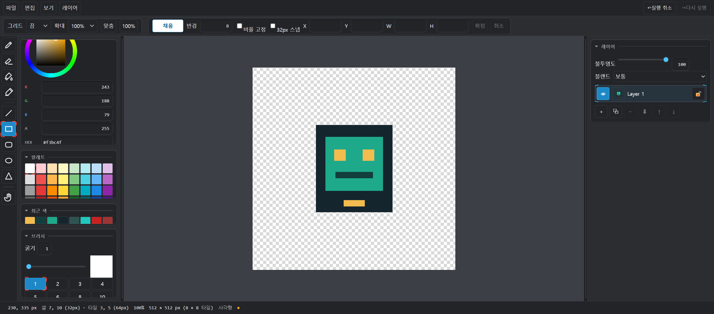

# Pixeldraw

타일 기반 2D 에셋을 위한 픽셀 아트 편집기입니다. 브러시·도형·레이어 편집, 실행 취소/다시 실행, PNG 및 문서 JSON 저장을 지원합니다. npm 런타임 의존성은 없고 빌드 단계도 없습니다(데스크톱 exe는 선택).


## 실행

Python 3가 설치된 환경에서 저장소 루트에서 실행합니다.

```bash
python run.py
```

로컬 서버가 빈 포트를 선택해 브라우저를 엽니다. `--port 8000`으로 포트를 지정하거나 `--no-browser`로 브라우저 자동 실행을 끌 수 있습니다. ESM을 사용하므로 `index.html`을 `file://`로 직접 열 수 없습니다.

저장 위치는 브라우저의 파일 저장 대화상자 또는 다운로드 설정이 결정합니다. 브라우저 보안상 앱이 임의의 `saves/` 폴더를 강제로 지정할 수는 없습니다. `saves/`는 로컬 산출물 보관용으로 Git에서 제외됩니다.

## 데스크톱 앱

Python이나 브라우저 없이 바로 실행하는 exe로도 쓸 수 있습니다. 인터넷이 없어도 동작합니다.

```bash
npm install          # @tauri-apps/cli (개발 의존성, 최초 1회)
npm run app:build    # src-tauri/target/release/pixeldraw.exe 생성
```

편집기 코드(`src/`)는 그대로입니다. `src-tauri/`(Rust)는 네이티브 파일 대화상자와
파일 쓰기만 맡고, `src/io/file_io.js`가 데스크톱에서는 네이티브 경로를, 브라우저에서는
기존 경로를 씁니다. 단, Windows의 WebView2 런타임을 사용하므로 Windows 10 21H2
이후·Windows 11에서 실행해야 합니다. 구조와 요구사항은 [docs/desktop.md](docs/desktop.md)에 적었습니다.

## 검증

Node.js 20 이상에서 전체 테스트와 렌더링 검증을 실행할 수 있습니다.

```bash
npm test                       # 410건 (네이티브 파일 브리지 6건 포함)
npm run parity                 # 201 골든 검사
npm run parity:assets          # 39/39
node tools/png_cases_check.mjs
node tools/view_check.mjs
python schema/schema_selfcheck.py
```

데스크톱 셸 쪽 검증은 `cd src-tauri && cargo test --lib`(base64 3건)과
`npm run app:build`입니다.

## 개발 문서

아키텍처 및 동작 계약은 [docs/contract.md](docs/contract.md), 모듈별 설명은 [docs/README.md](docs/README.md)에서 확인할 수 있습니다. 레이어 갤러리는 `python run.py` 실행 후 `/viewer/`에서 열 수 있습니다.
