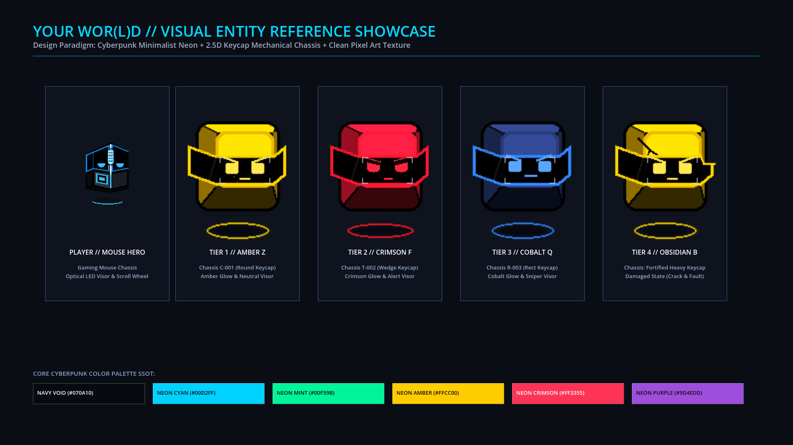
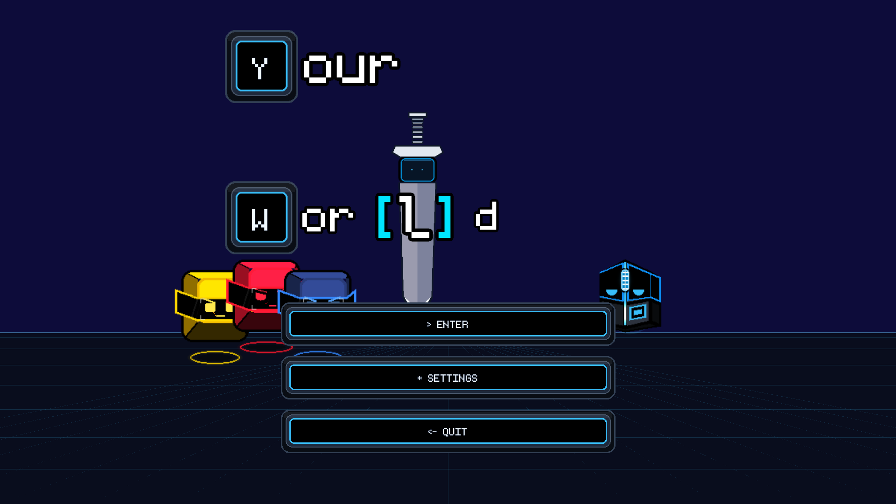
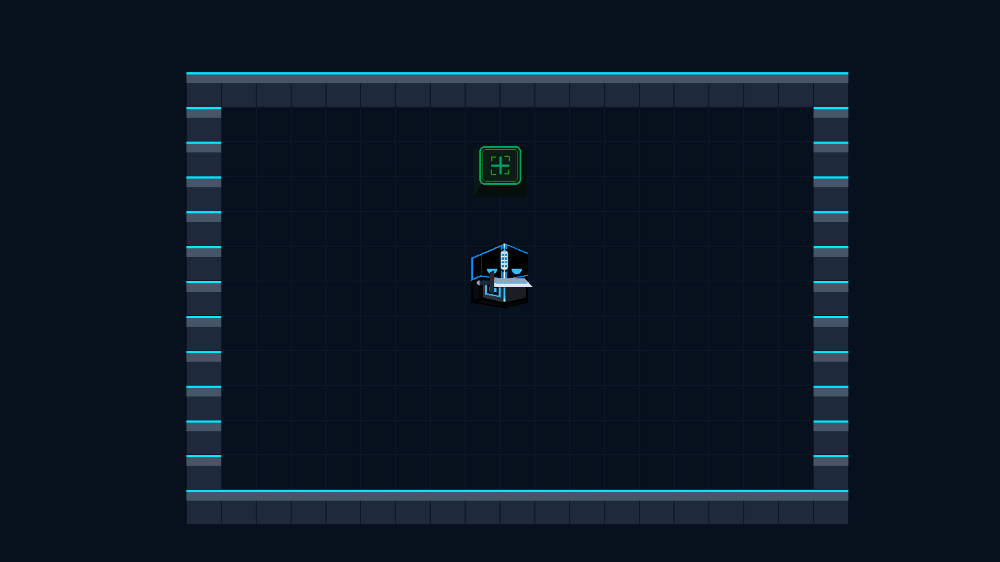
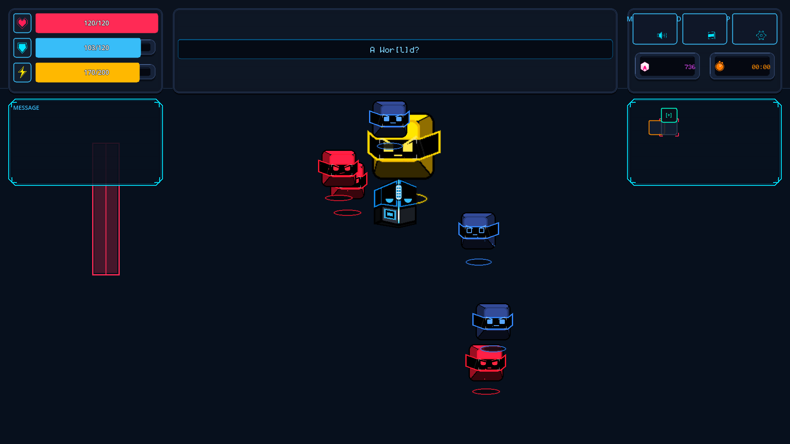
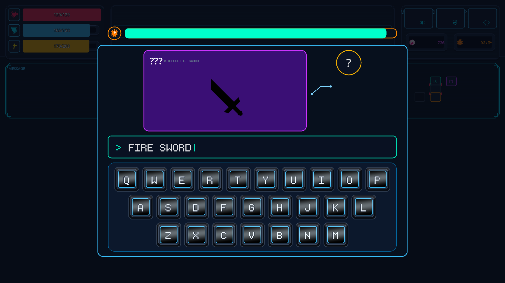
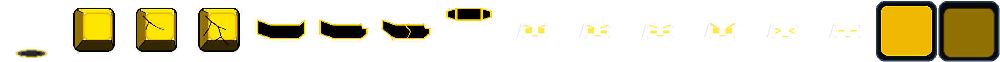
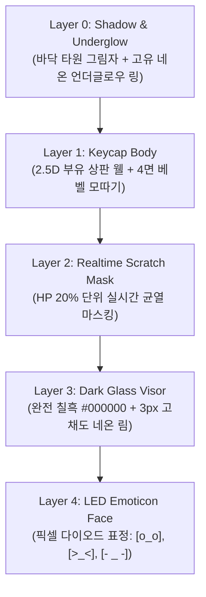

# GAME DESIGN VISUAL REFERENCE // YOUR WOR(L)D
> **Visual SSOT & Benchmark Guide**: Cyberpunk Minimalist Neon, 2.5D Keycap Mechanical Chassis, Clean Pixel Art Texture

---

## 1. Executive Summary & Design Identity

**Your wor(l)d**의 비주얼 정체성은 **'사이버펑크 네온 미니멀리즘(Cyberpunk Neon Minimalism)'** 과 **'기계식 키보드 부품의 물리적 생명체화(Keycap Biomechanics)'**, 그리고 **'군더더기 없는 정갈한 픽셀 아트 질감(Clean Pixel Texture)'** 의 결합으로 정의됩니다.

### Core Visual Equation
$$\text{Visual Identity} = \text{Dark Navy Void (\#070A10)} + \text{High-Contrast Neon Rim} + \text{2.5D Keycap Bevel} + \text{Minimal Pixel Cluster}$$

```
                [ VISUAL DESIGN PILLARS ]
                           │
      ┌────────────────────┼────────────────────┐
      ▼                    ▼                    ▼
[ Cyberpunk Minimal ] [ Keycap Chassis ]  [ Clean Pixel Art ]
 • Dark Navy / Charcoal • 2.5D Well & Bevel • High Readability
 • Emissive Neon Accents • Switch Socket    • Zero Visual Noise
 • LED Emoticon Visor   • 6-Tier Hierarchy  • Crisp Silhouette
```

---

## 2. In-Engine Visual Showcase (실제 인게임 캡처)

프로젝트 엔진(Godot 4.8 dev6)을 통해 직접 렌더링 및 캡처된 실제 에셋과 화면 구성입니다.

### 2.1 Flagship Entity Showcase: Player & Keybot Tier Lineup
게임 내 모든 유닛은 유기체적 생체 형태를 완전히 배제하고, 입력 장치(마우스, 키캡)의 입체 구조와 발광 소자로 조형됩니다.



| 엔티티 | 클래스 / 티어 | 섀시 형태 | 주요 비주얼 특징 및 발광 토큰 |
|:---|:---|:---|:---|
| **Mouse Hero** | Player | 게이밍 마우스 섀시 | 옵티컬 휠 마운트, 네온 시안 림, LED 픽셀 바이저 (`#00D2FF`) |
| **Amber Z-Crawler** | Tier 1 (ZXCV열) | C-001 (원형 키캡) | 앰버 골드 네온 림 (`#FFCC00`), 상판 웰 오목면, 중립 바이저 |
| **Crimson F-Piercer** | Tier 2 (ASDF열) | T-002 (삼각 웻지 키캡) | 크림슨 레드 네온 림 (`#FF3355`), 날카로운 베벨, 경계 LED |
| **Cobalt Q-Sniper** | Tier 3 (QWERTY열)| R-003 (직사각형 키캡) | 코발트 블루 네온 림 (`#00D2FF`), 장방형 바이저, 조준 HUD |
| **Obsidian B-Brute** | Tier 4 (WASD/숫자열)| 헤비 방호형 키캡 | 피격 실시간 크랙(20% 단위 균열 마스킹), 파손 바이저 |

---

### 2.2 Title & Spatial Identity (타이틀 디오라마)
어두운 심연의 그리드 공간 위에 기계식 키캡 조형 로고와 네온 발광 대검이 배치되어 게임의 묵직하면서도 날렵한 사이버펑크 톤을 제시합니다.



- **배경**: 딥 네이비 보이드(`PALETTE_NAVY_VOID`, `#070A10`)와 원근 그리드 라인.
- **로고**: 분리/조합 가능한 키캡 프레임 (`[Y]our`, `Wor[l]d`).
- **인터페이스**: 네온 시안 테두리와 모노스페이스 픽셀 폰트(`monogram.ttf`).

---

### 2.3 Dungeon & Combat Readability (전투 및 로비 룸)
불필요한 디테일로 캐릭터 시인성을 해치지 않도록, 벽면과 바닥 타일은 채도를 낮추고 경계선만 네온 라인으로 명확히 구분합니다.

| 로비 (Lobby Minimalist Hub) | 전투 방 진입 (Combat Swarm Encounters) |
|:---:|:---:|
|  |  |
| **특징**: 최소한의 그리드 타일 + 포탈 키캡 스위치 | **특징**: 고대비 엔티티 윤곽선으로 난전 중에도 즉각 식별 |

---

### 2.4 Typing & Crafting Modal (단어 조립 인터페이스)
전투 중 단어 조합 및 무기 제작 시 등장하는 키보드 모달 인터페이스입니다.



- **입력 프롬프트**: 터미널 커서 스타일 (`> FIRE SWORD|`)
- **키캡 인터페이스**: 3D 베벨이 적용된 QWERTY 물리 키보드 레이아웃.
- **블루프린트 스키매틱**: 네온 퍼플 프레임과 홀로그램 실루엣 와이어.

---

## 3. Benchmark Analysis: Soul Knight vs The Binding of Isaac

본 프로젝트가 지향하는 시각적 방향성을 정립하기 위해 탑다운 던전 장르의 대표작 2종과 비교 분석합니다.

```
[ 시각적 포지셔닝 맵 ]

     고밀도 / 판타지 디테일
                ▲
                │      [Soul Knight]
                │      • 다채로운 바이옴 & 아기자기한 색감
                │      • 캐릭터 외형 장식 다수
                │
플랫 / 그로테스크 ────────┼────────────────────────► 네온 사이버펑크 / 하이테크
 [The Binding of Isaac] │
 • 갈색/회색 저채도 던전  │      ★ [YOUR WOR(L)D]
 • 단일 방 집중 폐쇄 구조 │      • 딥 네이비 보이드 + 고대비 네온
 • 유기체 / 고어 텍스처   │      • 2.5D 기계식 키캡 섀시
                │      • 불필요한 노이즈 없는 극도의 정갈함
                ▼
     미니멀 / 고시인성
```

### 3.1 벤치마크 심층 비교표

| 비교 항목 | Soul Knight (소울나이트) | The Binding of Isaac (아이작) | **Your wor(l)d (본 프로젝트)** |
|:---|:---|:---|:---|
| **화면 시점** | 탑다운 쿼터뷰 (Top-Down Quarter) | 탑다운 직교 뷰 (Top-Down Orthogonal) | **탑다운 2.5D 직교 뷰 (2.5D Top-Down)** |
| **아트 스타일** | 16-bit 레트로 판타지 픽셀 | 16-bit 그로테스크 카툰 픽셀 | **사이버펑크 네온 미니멀 픽셀** |
| **색상 팔레트** | 자연물/판타지 기반 다채로운 RGB | 저채도 세피아, 암갈색, 핏빛 레드 | **딥 네이비 보이드 베이스 + 고채도 네온 5색** |
| **캐릭터 조형** | SD 비율 기사/마법사 생체 캐릭터 | 단순 구형(머리) + 눈물 흘리는 소년 | **키캡/마우스 기계 섀시 + LED 바이저** |
| **배경 디테일** | 바이옴별 장식물(풀, 기둥, 상자 등) 밀집 | 바닥 얼룩, 균열, 배설물, 바위 등 | **정갈한 모듈러 타일 + 림 라이팅 경계** |
| **HUD 설계** | 좌상단 3열 게이지 + 우상단 미니맵 | 좌상단 하트 + 상단 폭탄/열쇠/코인 | **좌상단 슬릭 3단 게이지 + 네온 박스 미니맵** |
| **난전 가독성** | 탄막과 캐릭터가 겹칠 때 시각 피로도 증가 | 캐릭터-바닥 명도 대비로 안정적 확보 | **블랙 바이저 + 고채도 네온 림으로 완벽한 분리** |

### 3.2 벤치마크를 통한 Your wor(l)d의 핵심 차별화
1. **소울나이트로부터의 수용과 정제**:
   - *수용*: 모바일/PC 모두에서 즉각 인지되는 굵고 깔끔한 외곽선과 경쾌한 피격 모션.
   - *차별화*: 소울나이트의 복잡하고 잡다한 판타지 오브젝트를 걷어내고, 기계식 키보드의 기능적 부품(스위치 웰, 소켓, 키캡)만 남겨 극도의 모던함을 유지.
2. **아이작으로부터의 수용과 정제**:
   - *수용*: 룸 단위 폐쇄형 전투의 극대화된 공간 집중도와 정갈한 카메라 프레이밍.
   - *차별화*: 음울하고 끈적한 유기체적 고어 텍스처 대신, 매끄럽고 차가운 다크 글래스와 발광 다이오드의 전자적 질감으로 치환.

---

## 4. Keybot Visual Anatomy (키봇 픽셀 에셋 구조 SSOT)

키봇(Keybot)은 **128×128 RGBA 슬롯 10개로 구성된 1280×128 스프라이트 아틀라스(`sheet.png`)** 를 기반으로 동작합니다. 런타임에 4개 레이어(`KeybotPuppet`)로 분리 합성되어 프로시저럴 애니메이션을 수행합니다.

### 4.1 실제 키봇 아틀라스 시트 (`kb_z_amber_t1.png`)


```
[ 1280px × 128px Atlas Slot Layout ]
┌───────┬───────┬───────┬───────┬───────┬───────┬───────┬───────┬───────┬───────┐
│ Slot 0│ Slot 1│ Slot 2│ Slot 3│ Slot 4│ Slot 5│ Slot 6│ Slot 7│ Slot 8│ Slot 9│
│Shadow │ Body  │ Glyph │Scratch│ Visor │Crack-V│Neutral│ Alert │Hurt(><│Dead(--│
└───────┴───────┴───────┴───────┴───────┴───────┴───────┴───────┴───────┴───────┘
   (0,0)  (128,0) (256,0) (384,0) (512,0) (640,0) (768,0) (896,0) (1024,0)(1152,0)
```

### 4.2 레이어별 조형 규칙



1. **상판 웰(Dish)과 4면 베벨(Bevel)**:
   - 기계식 키캡 고유의 오목한 상판 구조를 픽셀 명암 3단계로 표현.
   - 키캡의 경사각에 따라 상단 하이라이트(1px)와 하단 섀도우(2px)를 배치하여 확실한 2.5D 입체감 부여.
2. **다크 글래스 바이저 (Wrap-around Dark Visor)**:
   - **절대 규칙**: 바이저 바탕은 어떠한 반사광 노이즈도 섞이지 않은 **완전한 칠흑 (`#000000`)**.
   - 테두리는 3px 두께의 엔티티 고유 `$glow_color` 네온 림 적용.
3. **LED 픽셀 이모티콘 (Pixel Diode Expressions)**:
   - 사람의 생체 눈동자나 입술 대신 디지털 도트 매트릭스 이모티콘 사용.
   - 평상시: `[ _ ]` 또는 `[o_o]`
   - 경계/추적/공격: `[/ \ ]` 또는 `[>_<]`
   - 피격/임계: `[x_x]` 또는 스파크 점멸
   - 사망/전원 차단: `[- _ -]` 또는 소등

---

## 5. Pixel Art & Color System Specification

### 5.1 Core Color Tokens (Color Consts SSOT)

| 토큰명 | HEX 코드 | 용도 및 시각적 의미 |
|:---|:---:|:---|
| `PALETTE_NAVY_VOID` | `#070A10` | 월드 심연 배경, 화면 기본 베이스 |
| `PALETTE_NAVY_900` | `#0D1322` | 던전 바닥 타일, UI 패널 기본 배경 |
| `PALETTE_NAVY_700` | `#1A253D` | 키캡 바디 기본 베벨, 카드 컨테이너 테두리 |
| `PALETTE_CYAN_500` | `#00D2FF` | 플레이어 주 발광색, 쉴드 게이지, 인터페이스 포커스 |
| `PALETTE_GREEN_450` | `#00F59B` | 민트/에메랄드, 타이머 카운트다운, 성공/안전 지표 |
| `PALETTE_GOLD_400` | `#FFCC00` | 앰버/골드, Tier 1 키봇 발광, 스태미나/에너지 게이지 |
| `PALETTE_RED_500` | `#FF3355` | 크림슨 레드, Tier 2 키봇 발광, HP 게이지, 치명적 위험 |
| `PALETTE_PURPLE_500`| `#9D4EDD` | 네온 바이올렛, 블루프린트 합성 소켓, 신화급 단어 |

### 5.2 픽셀 질감 4대 원칙 (Clean Pixel Art Texture Rules)
1. **클러스터 미니멀리즘 (Minimal Pixel Clusters)**:
   - 텍스처 표면에 불필요한 단일 픽셀 디더링(dithering)이나 노이즈 픽셀을 일체 금지.
   - 단단한 2~3단계 톤 램프(Tone Ramp)만 사용하여 사물의 재질감을 표현.
2. **선명한 블랙 아웃라인 (Selective Outer Line)**:
   - 엔티티의 최외곽선은 1px 두께의 고대비 라인을 둘러 월드 배경과 100% 분리.
3. **하이-콘트라스트 림 라이트 (High-Contrast Rim Light)**:
   - 발광 부위는 1px 블러 셰이더나 글로우 없이, 고채도 픽셀 라인 자체로 발광 느낌을 직접 전달.
4. **모노스페이스 픽셀 타이포그래피 (Monospace Pixel Typography)**:
   - 인게임의 모든 영문 및 숫자는 고정폭 픽셀 폰트(`monogram.ttf`)를 사용하여 기계 콘솔 단말기 느낌 유지.

---

## 6. Visual DO / DON'T Checklists

| 구분 | DO (권장) | DON'T (엄격히 금지) |
|:---|:---|:---|
| **형태 (Form)** | • 기계식 키캡 상판 웰, 4면 베벨 모따기<br>• 마우스 휠, 스위치 소켓, 나사 홈, 방열 슬릿<br>• 기계적 당위성이 있는 기하학적 다각형 | • 유기체 동물/인간형 피부, 근육, 털<br>• 이유 없는 곡면이나 곡선 덩어리<br>• 키보드 기계 장치와 무관한 판타지 장식 |
| **색상 (Palette)**| • 칠흑/다크 네이비 배경 + 5대 고채도 네온 포인트<br>• 정의된 `CoreColorConsts` 상수 토큰 사용 | • 탁한 파스텔톤, 회색빛 중간 톤 남용<br>• 인라인 하드코딩된 임의의 RGB 색상<br>• 채도 100% 원색의 무분별한 혼합 |
| **표정 (Face)** | • 다크 글래스 바이저 위 픽셀 LED 이모티콘<br>• 상태 변화에 따른 기계적 도트 변형<br>• 바이저 피격 시 20% 단위 크랙 마스킹 | • 생체 동공/각막/홍채를 가진 눈동자<br>• 입술, 치아, 혓바닥 등 생체 구강 구조<br>• 반응 없는 정적 고정 얼굴 |
| **연출 (Juice)** | • 글자가 물리적으로 튀고 결합되는 키캡 이펙트<br>• 네온 림 펄스 발광, 스파크 방전 효과<br>• 타건감(기계식 스위치 클릭 반동) 모션 | • 판타지 마법진, 불꽃 파티클 남발<br>• 게임플레이와 연계되지 않는 정적 텍스트<br>• 물리적 타격감 없는 플랫 슬라이딩 |

---

## 7. Future Roadmap & Entity Expansion Guidelines

1. **키보드 6계층 확장 가이드**:
   - Tier 1 (ZXCV열): 원형/콤팩트 기동형 섀시
   - Tier 2 (ASDF열): 웻지/대시 돌파형 섀시
   - Tier 3 (QWERTY열): 직사각형/원거리 저격 섀시
   - Tier 4 (WASD & 숫자열): 헤비/방호/포격형 대형 섀시
   - Tier 5 (Function F1~F12열): 지휘/서포트/버프형 버텍스 섀시
   - Tier 6 (특수키 Enter, Esc, Space): 보스급 콤비네이션 섀시
2. **에셋 제작 표준**:
   - 모든 신규 키봇 에셋은 반드시 `1280×128` (10 슬롯) 아틀라스 규격을 준수하여 제작.
   - 무기 및 아이템은 `32×32` 또는 `48×48` 정방형 픽셀 캔버스에 1px 네온 림을 적용할 것.
