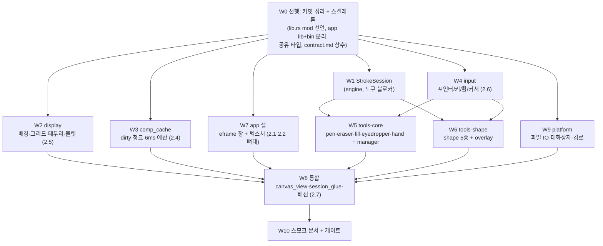
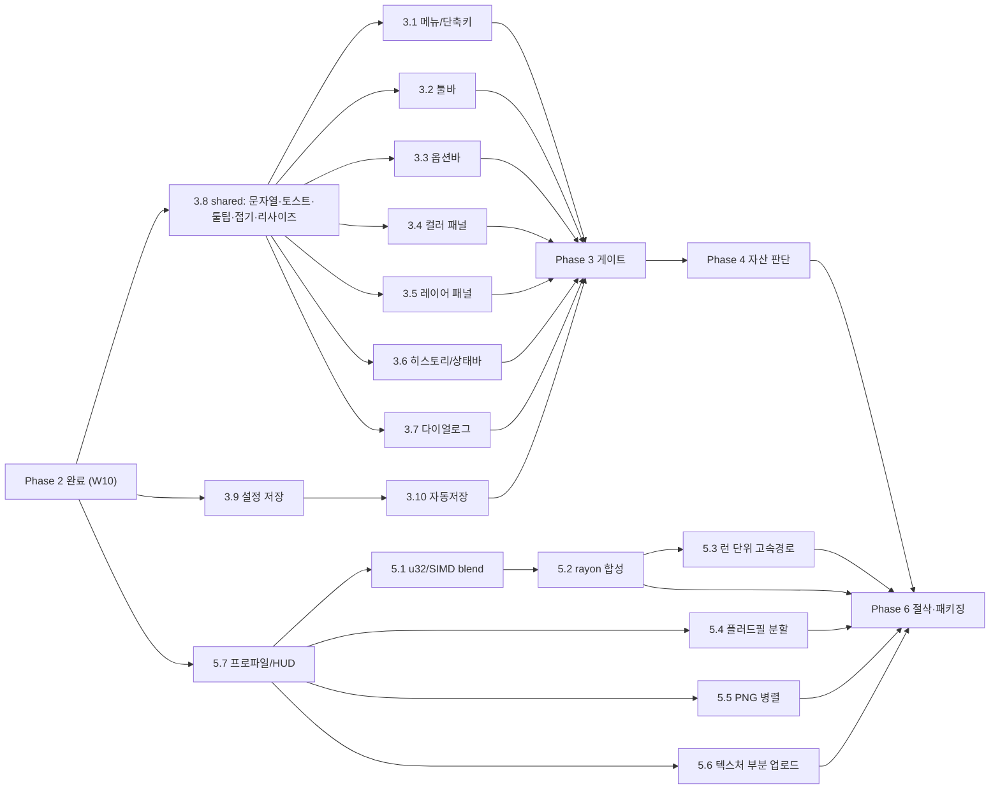

# 로드맵 명세 — Phase 2 ~ 6 (에이전트 위임용)

> 작성: 2026-10-11, Phase 1(엔진) 완료 시점의 실측 기준.
> `docs/native_plan.md`가 "무엇을 왜"라면, 이 문서는 **"누가 어떤 파일을 어떤 서명으로 어떤 기준까지"**
> 를 정한다. 작업자는 이 문서 + `docs/progress/README.md`(규칙) + `docs/contract.md`(상수)만
> 읽고 시작할 수 있어야 한다. 이 문서와 코드가 어긋나면 **코드가 맞다** — 어긋남을 로그에 적고 진행한다.

---

## 0. 현재 상태 (2026-10-11 실측)

| 항목 | 값 |
|---|---|
| `cargo test --workspace` | **321 / 321** 그린 (lib 284 + e2e_session 5 + fixtures 5 + model_basic 14 + model_history 11 + recipe_parity 1 + platform 1) |
| 엔진 규모 | `crates/engine/src` 약 18.5k줄 (테스트 포함), 최대 파일 601줄(`recipe/commands.rs`, 예약 면제) |
| `crates/app` | **스텁**. `main.rs` 14줄, 의존성은 `pixel-engine`·`pixel-platform`뿐. eframe 없음 |
| `crates/platform` | **스텁**. `lib.rs` 27줄, 의존성 0 |
| 툴체인 | cargo/rustc 1.99, `edition = "2024"`, `rust-version = "1.90"`, `unsafe_code = "forbid"` |
| 네트워크 | crates.io 접근 가능(`cargo info eframe` 확인). `eframe` 최신 0.36.2, 0.33.3도 받아짐 |

### 0-1. 미커밋 작업 (Phase 1.13)

`git status` 기준 **1.13 결과물이 커밋되지 않았다.** 보드는 `[x] 1.13`로 체크되어 있다.

- 수정: `crates/engine/src/{io/mod.rs, io/png/{decode,tests}.rs, lib.rs, raster/gradient.rs}`, `crates/engine/tests/fixtures.rs`, `docs/native_plan.md`, `docs/progress/{README,log}.md`, `tools/recipe_cases.mjs`
- 신규: `crates/engine/src/io/{serialize,validate,vector}.rs`, `io/{serialize,validate}/`, `crates/engine/src/recipe.rs`, `recipe/`, `crates/engine/tests/recipe_parity.rs`, `tools/recipe_cases.json`
- **제외(커밋 금지)**: `.manus/ .serena/ .work/ outputs/` 및 README 규칙 2의 사용자 WIP(`src/ tests/ asset_work/ viewer/`)

**W0의 첫 단계에서 사람이 커밋 여부를 정한다.** 에이전트는 사용자 승인 없이 커밋하지 않는다.
커밋 시 메시지: `phase 1.13: io/serialize + vector/recipe/validate (39/39 native parity)`.

### 0-2. 반드시 알아야 할 코드 사실 (Phase 2 설계를 좌우)

1. **`EditHandle<'a>`는 `Session`을 `&mut`로 빌린 채 산다.**
   `Session::begin_edit(&mut self, EditOptions) -> EngineResult<EditHandle<'_>>`
   (`model/session/core.rs:269`)은 `PixelWriter<'a>`(`&'a mut ChunkStore` 보유, `chunkstore/writer.rs`)와
   `&'a mut SessionCore`를 핸들에 넣는다. JS의 펜 도구는 `pointerDown`에서 `edit`를 만들어
   **여러 이벤트에 걸쳐 필드로 들고 있다.** Rust에서는 도구가 이 핸들을 필드로 가질 수 없다
   (자기참조·이중 가변 빌림). → **W1(StrokeSession)이 선행 블로커다.** §3 W1 참조.
2. **세션 이벤트는 `'static FnMut` 클로저**(`Session::subscribe`, `model/event.rs:44`)이고
   콜백에서 세션·도구에 접근할 수 없다. 앱은 구독 클로저가 `Rc<RefCell<VecDeque<ModelEvent>>>`
   큐에 push하고, 프레임마다 큐를 drain해 도구·렌더러·패널에 전달한다(W8).
3. **`is_editing`은 핸들을 commit/cancel 없이 버리면 영구히 true**다(JS `session._edit` 패리티, 테스트로 고정).
   기존 `begin_edit` 경로는 **바꾸지 않는다.** 새 API를 **추가**한다.
4. **엔진 `Session`에는 `view`가 없다.** 뷰는 `engine/src/view/`(`ViewStore`, `View`, `Viewport`)가 별도로
   소유하고 Phase 2.3에서 이미 끝났다(`docs/view_math.md`).
5. **합성은 이미 있다**: `composite::composite_chunk(&[LayerSource], cx, cy, &mut [u8; 4096])`,
   `sample_pixel`, `Document::layer_sources()`. **배경은 합성에 없다** — 표시 렌더러 책임(JS와 동일).
6. 래스터 커널은 `raster::brush::{stroke_point, stroke_segment, stamp_brush}`(`PixelSink` 트레이트),
   `kernels::flood_fill_scanline`, `raster::shape_raster`(`apply_shape`)가 이미 있다.
   **`PixelWriter`가 `PixelSink`를 구현하는지 확인할 것**(없으면 W1에서 어댑터 추가).
7. 언어: 사용자 문자열(토스트·라벨)은 JS와 **글자 그대로** 같다(예: `"연필"`, `"지우개"`, `"페인트통"`,
   `"이미 같은 색입니다"`, `"투명 픽셀"`). 임의로 번역·수정하지 않는다.

---

## 1. 운용 규칙 (README 규칙 6 요약 + 이번 추가)

1. **파일 disjoint.** 각 작업(W)은 §3에 적힌 "쓰기 범위" 밖을 수정하지 않는다. 밖의 코드가 막으면
   수정하지 말고 **로그에 "막힘"으로 적고 멈춘다.** (공유 지점 `lib.rs`·`Cargo.toml`·`contract.md`는 W0가 선작업)
2. **모듈 300줄 검토 / 400줄 하드리밋.** 넘으면 파사드 분할(`foo.rs` + `foo/`, `mod`+`pub use`만).
3. **주석은 트랩만.** JS 패리티 트랩, 실측 수치, 일부러 고치지 않은 이유, 연산 순서. 긴 설명은 `docs/*.md`에 쓰고 소스엔 한 줄 포인터.
4. **상수는 `docs/contract.md` 먼저.** 모듈에 새 숫자를 하드코딩하지 않는다
   (이번 Phase 신규 후보: `FRAME_BUDGET_MS=6`, `CHECKER_A/B`, `CHECKER_CSS_PX=8`, `BORDER_RGBA`, 그리드 알파 3종).
5. **게이트는 매 작업 끝에 전부 실행**하고 숫자를 로그에 적는다(전→후).
   ```bash
   cargo test --workspace
   cargo clippy --workspace --all-targets -- -D warnings
   cargo fmt --all --check
   ```
   JS 쪽을 건드린 작업만 추가로 `npm test`(410/410)와 `node tools/oracle_manifest.mjs --check`.
6. **로그 1줄 + 보드 체크**: `docs/progress/log.md` 최신이 위. 형식은 기존 항목 따라
   `## YYYY-MM-DD · Phase N.M · 제목` + 커밋 대상 + 테스트 수(전→후) + 막힌 점. 같은 파일을 여러 에이전트가
   동시에 편집하면 충돌하므로 **로그·보드는 에이전트가 쓰지 않고 오케스트레이터(사람/메인 AI)가 합친다.**
   각 에이전트는 최종 메시지에 "로그 초안"을 반환한다.
7. **커밋은 하지 않는다**(사용자 요청 시에만). 커밋 대상 경로는 README "커밋 대상 경로" 표.
8. `unsafe` 금지(워크스페이스 lint). `wide` 같은 안전 래퍼 SIMD는 가능.
9. **JS 원본은 읽기 전용**(`src/`, `tests/`, `reference/`). 수정 금지. 필요하면 `tools/*.mjs`에 **새** 오라클 스크립트를 추가.

---

## 2. 의존성 그래프

### 2-1. Phase 2 작업 단위



### 2-2. 실행 웨이브

| 웨이브 | 작업 | 병렬도 | 선행 조건 |
|---|---|---|---|
| **0** | W0 | 1 (직렬, 작음) | 없음 |
| **1** | W1 · W2 · W3 · W4 · W7 · W9 | **6 병렬** | W0 머지 |
| **2** | W5 · W6 | 2 병렬 | W1, W4 머지 |
| **3** | W8 | 1 (직렬) | W2·W3·W5·W6·W7·W9 머지 |
| **4** | W10 | 1 | W8 |

쓰기 범위가 겹치지 않으므로(§3 표) 웨이브 1·2는 같은 워킹트리에서 동시에 돌려도 된다. 단 **컴파일 격리**를 위해
각 에이전트는 `cargo test -p <자기 크레이트> <자기 모듈>`로 자기 범위를 먼저 검증하고, 워크스페이스 전체
게이트는 웨이브 종료 시 오케스트레이터가 한 번 돈다(다른 에이전트의 미완성 코드 때문에 깨질 수 있음).

### 2-3. Phase 3~6 개요 그래프



Phase 5는 **Phase 3와 병행 가능**하다(엔진·`canvas_view`만 건드리고 UI 패널은 건드리지 않음). 단 `5.1`과 `5.2`와 `5.3`은
모두 `composite.rs`/`blend.rs`를 수정하므로 **직렬**(5.1 → 5.2 → 5.3).

---

## 3. Phase 2 — 작업 명세

공통 규약(모든 W):
- 새 코드는 **JS 동작을 복제**한다. "더 나은" 동작으로 바꾸지 않는다. 의문이 생기면 JS 원본을 읽는 쪽이 정답.
- 각 W는 자기 모듈에 단위 테스트를 포함한다. JS 오라클이 필요한 곳은 W별로 명시.
- 각 W의 "수용 기준"을 전부 만족해야 완료.

---

### W0 — 선행 정리·스켈레톤 (직렬, 작음)

**목적**: 병렬 작업이 서로의 공유 파일을 건드리지 않도록 **공유 지점을 한 번에** 만들어 둔다.

**쓰기 범위**: `Cargo.toml`(루트), `crates/*/Cargo.toml`, `crates/engine/src/lib.rs`, `crates/app/src/{lib.rs,main.rs}`,
`crates/app/src/{input,tools}/mod.rs`(빈 파사드 + 공유 타입), `docs/contract.md`.

**작업**
1. §0-1 미커밋 정리(사람 승인 후 커밋 또는 보류).
2. `engine/src/lib.rs`에 `pub mod display;`, `pub mod comp_cache;` 추가하고 각각 **빈 파사드 파일**
   (`display.rs`, `comp_cache.rs`)을 만든다. 이후 W2/W3는 `display/`·`comp_cache/` 디렉터리에만 쓴다.
3. `crates/app`을 **lib + bin**으로 분리: `src/lib.rs`(`pub mod input; pub mod tools;`…) + `src/main.rs`(얇은 진입점).
   라이브러리 이름 `pixeldraw_app`. 목적은 **egui 없이 `cargo test`로 입력·도구 로직을 검증**하는 것.
   `[dependencies]`: 이 시점엔 `pixel-engine`, `pixel-platform`만. eframe은 **W7만** 추가한다.
4. **공유 타입 확정**(`app/src/input/event.rs`, §3 W4/W5/W6 공통 계약). 시그니처는 아래 "공유 계약" 그대로, 본문은 `todo!()` 금지 — 순수 데이터 타입이므로 완성해서 넣는다.
5. `docs/contract.md`에 Phase 2 신규 상수 표 추가(§1 규칙 4의 후보 전부). 값은 JS 원본에서 복사:
   `FRAME_BUDGET_MS=6`(render/renderer_composite.js), `CHECKER_A=#ffffff`, `CHECKER_B=#d9d9d9`, `CHECKER_CSS_PX=8`(render/background.js),
   `BORDER_RGBA=(0,0,0,0.6)`(render/renderer_display.js), `GRID_ALPHA_THIN=0.3`, `GRID_ALPHA_THICK=0.55`, `GRID_ALPHA_PIXEL=0.15`,
   `GRID_THIN_CSS_PX=1`, `GRID_THICK_CSS_PX=2`, `GRID_BEVEL_DEV_PX=1`, 패스 알파(thick: 밝 0.44/어두 0.5, thin: 밝 0.3/어두 0.32).
   각 상수에 `engine/src/constants.rs` 대응 상수를 만들고 `constants` 테스트에 핀한다.

**공유 계약 — `crates/app/src/input/event.rs`** (W4/W5/W6가 이 타입에 의존; 변경 금지, 필요 시 W0 재오픈)

```rust
#[derive(Clone, Copy, Debug, PartialEq, Eq)]
pub enum Button { Left, Middle, Right }          // JS button 0/1/2

#[derive(Clone, Copy, Debug, PartialEq, Eq)]
pub enum PointerKind { Mouse, Pen, Touch }

/// JS buildToolEvent 결과의 1:1. (src/tools/pointer_event.js)
#[derive(Clone, Debug, PartialEq)]
pub struct ToolEvent {
    pub x: i32, pub y: i32,           // pixelAt(view, sx, sy)
    pub fx: f64, pub fy: f64,         // screenToCanvas (float canvas coords)
    pub sx: f64, pub sy: f64,         // host-relative screen (CSS/logical px)
    pub button: Button,
    pub shift: bool, pub ctrl: bool,  // ctrl = ctrl || meta
    pub alt: bool,
    pub pointer_id: u64,
    pub pointer_kind: PointerKind,
    pub coalesced: Vec<(i32, i32)>,   // 비어 있지 않음. 연속 중복 제거. 마지막 == (x, y)
    pub time_ms: f64,
}

#[derive(Clone, Copy, Debug, PartialEq)]
pub struct HoverEvent { pub x: i32, pub y: i32, pub fx: f64, pub fy: f64 }

#[derive(Clone, Debug, PartialEq)]
pub struct KeyEvent { pub key: String, pub code: String,
                      pub shift: bool, pub ctrl: bool, pub alt: bool, pub repeat: bool }
```

**공유 계약 — `crates/app/src/tools/api.rs`** (W5/W6/W8 공통)

```rust
pub struct ToolCx<'a> {
    pub session: &'a mut pixel_engine::model::Session,
    pub view: pixel_engine::view::View,      // Copy 스냅샷. 도구는 뷰를 바꾸지 않는다
    pub need_render: &'a mut bool,           // JS requestRender()
}

#[derive(Clone, Debug, PartialEq, Eq)]
pub enum CursorKind { Default, Crosshair, Grab, Grabbing, Pen, Eraser, Fill, Eyedropper, Cell, Copy /* …JS data-URI 커서는 enum으로 */ }

pub trait Tool {
    fn id(&self) -> &'static str;                               // "pen" "eraser" "fill" "eyedropper" "hand" "rect"… (settings TOOL_IDS와 일치)
    fn cursor(&self) -> CursorKind { CursorKind::Default }
    fn activate(&mut self, _cx: &mut ToolCx) {}
    fn deactivate(&mut self, _cx: &mut ToolCx) {}
    fn pointer_down(&mut self, _ev: &ToolEvent, _cx: &mut ToolCx) {}
    fn pointer_move(&mut self, _ev: &ToolEvent, _cx: &mut ToolCx) {}
    fn pointer_up(&mut self, _ev: &ToolEvent, _cx: &mut ToolCx) {}
    fn cancel(&mut self, _cx: &mut ToolCx) {}
    fn hover(&mut self, _ev: Option<&HoverEvent>, _cx: &mut ToolCx) {}
    fn key_down(&mut self, _ev: &KeyEvent, _cx: &mut ToolCx) -> bool { false }
    fn accepts_button(&self, b: Button) -> bool { b == Button::Left }
    fn has_pending(&self) -> bool { false }
    fn discard_pending(&mut self, _cx: &mut ToolCx) {}
    fn on_model_event(&mut self, _ev: &pixel_engine::model::ModelEvent) {}   // DOCUMENT_REPLACED/LAYERS 등 JS 구독 대체
    fn overlay(&self, _info: &OverlayInfo, _out: &mut Vec<OverlayOp>) {}
}
```

`OverlayOp`/`OverlayInfo`는 W6 범위의 타입이지만 W5(pen 브러시 프리뷰)도 쓰므로 **W0가 정의**한다(`tools/overlay.rs`):

```rust
pub struct OverlayInfo { pub view: View, pub dpr: f64 }       // 좌표계: 장치 픽셀
pub enum OverlayOp {
    FillRect   { x: f64, y: f64, w: f64, h: f64, rgba: [u8; 4] },
    StrokeRect { x: f64, y: f64, w: f64, h: f64, rgba: [u8; 4], dash: Option<(f64, f64)>, difference: bool },
    Line       { x0: f64, y0: f64, x1: f64, y1: f64, rgba: [u8; 4], width: f64, dash: Option<(f64, f64)>, difference: bool },
    Polyline   { pts: Vec<(f64, f64)>, closed: bool, rgba: [u8; 4], width: f64, dash: Option<(f64, f64)>, difference: bool },
    Circle     { cx: f64, cy: f64, r: f64, fill: Option<[u8; 4]>, stroke: Option<[u8; 4]>, width: f64 },
}
```
W6가 shape 오버레이 중 이 5종으로 표현 못 하는 것을 만나면 **새 변종 추가가 필요하다는 로그를 남기고 중단** (W0 재오픈).
`difference: true`는 W8의 오버레이 래스터라이저가 W2의 `difference` 합성 함수로 그린다.

**수용 기준**: `cargo test --workspace` 321 이상 유지, clippy/fmt 그린, `cargo run -p pixeldraw`가 기존 스텁 출력으로 정상 종료.

---

### W1 — StrokeSession (엔진, **도구 블로커**)

**목적**: 포인터 이벤트 사이에 걸쳐 살아 있는 편집(스트로크)을 `Session`이 **소유**하게 해,
도구가 빌림 없이 `down → move* → up/cancel`을 구현할 수 있게 한다.

**쓰기 범위**: `crates/engine/src/chunkstore/writer.rs`, `crates/engine/src/model/edit_session.rs`,
`crates/engine/src/model/session/{core.rs,ops.rs}`(신규 메서드만), 새 파일 `crates/engine/src/model/session/stroke.rs`
(+ 필요 시 `chunkstore/stroke_state.rs`), 테스트 `crates/engine/tests/stroke_session.rs`.
**기존 `begin_edit`/`EditHandle`/`PixelWriter::new` 동작·시그니처·테스트는 바꾸지 않는다.**

**설계(권장안 — 더 나은 안이 있으면 로그에 근거와 함께 변경 가능)**
- `PixelWriter`의 내부 상태(`before: BTreeMap<u64, Option<Box<Chunk>>>`, `dirty`, `last_key`, `layer_id`)를
  `StrokeState`로 분리. `PixelWriter<'a>`는 `{ store: &'a mut ChunkStore, state: StrokeState }`을 유지하되
  `PixelWriter::resume(store, state) -> Self`, `fn suspend(self) -> StrokeState` 를 추가한다.
  기존 `new/finish/discard/set/get/take_dirty/touched` 동작과 `done` 가드(`panic!("PixelWriter is finished")`)는 보존.
- `SessionCore`에 `stroke: Option<StrokeState>`(+ 라벨)를 둔다.

```rust
impl Session {
    /// begin_edit와 같은 가드·같은 status_message(레이어 잠김/숨김)·같은 에러 코드. 성공 시 editing=true.
    pub fn stroke_begin(&mut self, opts: EditOptions) -> EngineResult<()>;
    /// 활성 스트로크가 있으면 해당 레이어 store를 재차용해 PixelWriter를 만들어 f에 넘기고, 끝나면 suspend.
    /// 스트로크가 없거나 레이어/문서가 사라졌으면 INVALID_STATE (그리고 스트로크 폐기).
    pub fn stroke_with<R>(&mut self, f: impl FnOnce(&mut PixelWriter<'_>) -> R) -> EngineResult<R>;
    /// EditHandle::flush 동치: dirty를 비우고 PIXELS_CHANGED 이벤트 emit. 반환 = 비운 청크 목록
    pub fn stroke_flush(&mut self) -> Vec<(u32, u32)>;
    /// EditHandle::commit 동치(history.record(PaintCommand), dispatch_effects, editing=false). 반환: 변경 있었는지
    pub fn stroke_commit(&mut self, label: Option<&str>) -> EngineResult<bool>;
    /// EditHandle::cancel 동치(before-image 복원 + PIXELS_CHANGED + editing=false)
    pub fn stroke_cancel(&mut self);
    pub fn has_stroke(&self) -> bool;
}
```
- 새 API는 `is_editing()`을 `begin_edit`과 동일하게 올리고 내린다. 두 경로를 **동시에 쓰지 않는다**(`already editing` 가드가 막는다).
- `stroke_with` 안에서 `PixelSink`로 쓸 수 있어야 한다: `PixelWriter`가 `raster::PixelSink`를 구현하지 않으면
  `pub struct SinkAdapter<'w,'a>(&'w mut PixelWriter<'a>)`로 i32↔u32 경계 처리(범위 밖 무시, `get`은 범위 밖 0)를 추가.
- 스트로크 도중 `new_document`/`load_document`/`undo`/`redo`가 호출되면: `undo/redo`는 기존대로 `editing`이면 `Ok(None)`(`step()` 가드 보존).
  `load_document`/`new_document`는 스트로크를 **먼저 폐기**(cancel 동치, 이벤트 없이) 후 설치.

**테스트(필수)**
1. `stroke_begin → stroke_with(점 찍기) → stroke_flush → stroke_commit`이 **`begin_edit` 경로와 바이트 동일한 히스토리 엔트리**를 만든다(같은 changeset, undo 후 원복).
2. 여러 `stroke_with` 호출에 걸쳐 before-image가 유지된다(청크 두 개를 두 호출로 건드린 뒤 `cancel`→둘 다 원복, 신규 청크는 제거).
3. 잠긴/숨긴 레이어에서 `stroke_begin`이 같은 에러 코드와 같은 status 이벤트를 낸다.
4. 스트로크 중 `undo()`는 no-op, 스트로크 중 `begin_edit`/`stroke_begin`은 `already editing`.
5. 스트로크 중 레이어 삭제 후 `stroke_with`는 `INVALID_STATE`이고 `is_editing()`이 false로 복구된다.
6. 기존 테스트 321건 전부 그대로 통과(특히 "abandoned handle leaves editing set" 패리티 테스트).

**수용 기준**: 위 6종 + 게이트. `docs/model_internals.md`에 §8 "StrokeSession" 짧게 추가(설계 근거 + 위 트랩).

---

### W2 — display: 배경·그리드·테두리·블릿 (Phase 2.5, 엔진 순수)

**목적**: JS `render/{background,grid,renderer_display}.js`를 **CPU 프레임버퍼 함수**로 이식한다.
DOM·egui·GPU 의존 0. 출력은 `Vec<u8>` RGBA(장치 픽셀).

**쓰기 범위**: `crates/engine/src/display.rs`(파사드) + `crates/engine/src/display/**`, `crates/engine/tests/display_parity.rs`,
새 오라클 `tools/display_cases.mjs` + `tools/display_cases.json`. **다른 파일 수정 금지.**

**JS 원본**: `src/render/background.js`(50), `grid.js`(134), `renderer_display.js`(54). 반드시 전부 읽는다.

**모듈 분할(권장)**
```
display.rs                 // mod + pub use 만
display/framebuffer.rs     // Framebuffer { w, h, rgba: Vec<u8> }, fill_rect, blend_rect(source-over α), difference_rect(α)
display/background.rs      // paint_checker, paint_background  (JS paintChecker/paintBackground)
display/grid.rs            // grid_lines(view, w, h, vw, vh, mode) -> Option<GridLines>, paint_grid
display/frame.rs           // draw_display(...) : 배경→블릿→그리드→테두리, blit_visible
display/tests.rs
```

**공개 서명(고정)**
```rust
pub struct Framebuffer { pub width: u32, pub height: u32, pub rgba: Vec<u8> }
impl Framebuffer { pub fn new(w: u32, h: u32) -> Self /* 투명 0 */; pub fn clear(&mut self); /* …내부용 */ }

pub enum GridMode { Off, Unit, Tile, Pixel }              // "off"|"unit"|"tile"|"pixel"
pub struct GridStroke { pub g: u32, pub a: f64 }          // JS {g, a}: a가 팔레트 마커
pub struct GridLines { pub xs: Vec<GridStroke>, pub ys: Vec<GridStroke> }
pub fn grid_lines(view: &View, w: u32, h: u32, vw: f64, vh: f64, mode: GridMode) -> Option<GridLines>;
pub fn grid_stroke_dev_px(a: f64, dpr: f64) -> u32;

pub struct DisplayParams<'a> {
    pub view: View, pub canvas_w: u32, pub canvas_h: u32,
    pub css_w: f64, pub css_h: f64, pub dpr: f64,
    pub background: &'a str,            // "transparent" | "#rrggbb[aa]"
    pub grid: GridMode,
    pub comp: Option<&'a [u8]>,         // canvas_w*canvas_h*4 RGBA (W3의 comp 버퍼)
}
/// 반환 프레임버퍼 크기 = round(css*dpr) (최소 1). 투명(0)으로 시작해 JS drawDisplay와 같은 순서로 칠한다.
pub fn draw_display(p: &DisplayParams) -> Framebuffer;
pub fn draw_display_into(p: &DisplayParams, fb: &mut Framebuffer);   // 재사용 버퍼(할당 회피)
```

**패리티 트랩(반드시 보존)**
1. `grid_lines`는 **순수 함수**이며 JS와 동치여야 한다: 임계 `CHUNK_PX*z >= 6`, `TILE_PX*z >= 6`, `z >= 8`,
   `pushLines`의 `k0=max(0,ceil(max(0,lo)/step))`, `k1=min(max/step, floor(min(max,hi)/step))`, **pixel 줄이 인덱스 0부터**(thinnest-first, tile이 unit 위에 그려짐).
   → `tools/display_cases.mjs`로 (view, w, h, vw, vh, mode) 격자 ≥ 40케이스의 `gridLines` 출력을 JSON으로 덤프하고 Rust가 **동일**함을 검증.
2. `grid_stroke_dev_px`: **ceil**(round 아님). pixel 알파(0.15)는 dpr 무관 1px 고정.
3. 프레임 위치: `dx=round(offsetX*dpr)`, `dw=round(w*zoom*dpr)` — 각각 **개별 반올림**(우하단을 dx+dw로 계산하지 말 것).
4. `blit_visible`: `x0=max(0,floor(-offsetX/zoom))`, `sw=min(w, ceil((cssW-offsetX)/zoom)) - x0`, 목적 rect는 `round((offsetX+x0*zoom)*dpr)` 시작, 폭 `round(sw*zoom*dpr)`.
   **최근접 확대**(imageSmoothingEnabled=false). 같은 소스 픽셀이 어느 목적 픽셀에 대응하는지는
   `src = floor((dest_px - dest_origin) * sw / ddw)` 로 정의하고 문서화한다(캔버스 구현은 브라우저마다 달라 완전 비트 일치를 요구하지 않음 → **정수 줌에서 정확, 비정수 줌에서는 위 정의가 계약**).
5. 체커는 **화면 고정**(문서에 안 붙음, 장치 원점 기준 `cell = max(1, round(8*dpr))`, `(ix+iy)%2 != 0`일 때 B색). 뷰포트 교집합만 칠함.
6. `bg.a !== 255`이면 체커 위에 배경을 source-over로 덮음. `bg.a === 255`면 단색만(체커 생략 가능하나 결과는 동일해야 함).
7. 그리드 베벨: 밝은 패스(흰색, 알파 = `pass_alpha(a,false)`) 뒤 **trailing edge 1 장치px**에 어두운 패스(검정, `pass_alpha(a,true)`). 1px 헤어라인은 `difference` 합성.
   - source-over 8비트 연산: `out = round(dst*(1-a) + src*a)`를 **f64로 계산 후 `floor(v+0.5)`**(프로젝트의 `rnd`). α는 프레임버퍼에서 dst가 불투명이라고 가정하되 dst.a<255도 **일반 source-over**로 처리.
   - difference(불투명 dst, 흰 src, 알파 a): `out = round(dst*(1-a) + a*|dst - 255|)` = `round(dst*(1-a) + a*(255-dst))`. 이 공식을 `framebuffer.rs` 주석 1줄 + `docs/render.md`에 기록.
   - **이 합성식은 브라우저 캔버스와 ±1 오차가 날 수 있다.** 게이트는 "공식 자체를 단위 테스트로 고정"이지 브라우저 비트 일치가 아니다. 이 사실을 `docs/render.md`에 명시.
8. 테두리: `BORDER_RGBA` 1px을 캔버스 rect 바깥 4변(`dx-1..dx+dw+1` 등)에 칠한다. **클립 밖**이므로 클립 없이 그림(캔버스 rect의 클립은 배경·블릿에만 적용). 그리드는 rect 클립 안.
9. 오버레이는 W2 범위가 아니다(`DisplayParams`에 오버레이 없음). W8이 `draw_display` 결과 위에 `OverlayOp`를 래스터한다. 단 W8이 쓸 수 있게 `Framebuffer::{fill_rect, blend_rect, difference_rect, draw_line}`는 `pub`으로 노출.

**테스트(필수)**
- 격자 오라클 패리티(위 1) 전 케이스 일치.
- 체커: dpr 1/1.25/1.5/2에서 셀 크기·위상, 뷰포트 교집합 최적화가 전체 루프와 동일한 픽셀을 내는지(작은 뷰포트에서 브루트포스 대조).
- 배경 4종: transparent / `#rrggbb` / `#rrggbbaa`(a=0·a=128) / 잘못된 문자열(→ 체커).
- 그리드 4모드 × z∈{0.25,1,2,8,32}에서 선 위치·두께·베벨 픽셀 단위 단언(작은 뷰에서 손계산 기대값).
- `draw_display` 통합: 2×2 comp 한 장을 zoom 8로 그렸을 때 8×8 블록 4개가 정확히 나옴(정수 줌 최근접), 테두리·그리드 위치.
- 성능 스모크(`#[ignore]` 벤치 아님, 일반 테스트에서 시간 단언 금지): 1920×1080 한 프레임 `draw_display_into`가 패닉 없이 끝남. 수치는 `crates/engine/examples/bench.rs`에 항목 추가해 로그에 기록.

**수용 기준**: 위 테스트 + 게이트 + `docs/render.md`에 Rust display 절 추가.

---

### W3 — comp_cache: dirty 청크 합성 캐시 + 6ms 예산 (Phase 2.4, 엔진 순수)

**목적**: JS `renderer_composite.js` + `renderer.js`의 dirty 집합·이벤트 무효화·프레임 예산을 이식.

**쓰기 범위**: `crates/engine/src/comp_cache.rs`(파사드) + `crates/engine/src/comp_cache/**`, `crates/engine/tests/comp_cache.rs`. 다른 파일 금지.

**JS 원본**: `src/render/renderer_composite.js`(62), `renderer.js` 중 `_onPixels/_onLayers/_onSettings/_update/invalidate*`(224줄 전체 읽을 것).

**공개 서명(고정)**
```rust
pub struct CompCache { /* width, height, comp: Vec<u8>(w*h*4), dirty: BTreeSet<u64>, dirty_all: bool */ }
impl CompCache {
    pub fn new() -> Self;
    /// ensureComp: 크기가 바뀌면 버퍼 재할당(투명 0) + dirty_all=true. 같으면 no-op
    pub fn ensure(&mut self, canvas_w: u32, canvas_h: u32);
    pub fn invalidate_all(&mut self);
    pub fn invalidate_chunks(&mut self, chunks: &[(u32, u32)]);       // 캔버스 밖 청크는 무시
    /// 반환: 렌더(프레임) 재요청이 필요한지. JS _onPixels/_onLayers/_onSettings 규칙 그대로
    pub fn apply_event(&mut self, ev: &ModelEvent) -> bool;
    /// 가시 청크 전부(무예산) → 남은 dirty를 budget 안에서. 반환: 아직 dirty가 남았는지
    pub fn paint_dirty(&mut self, layers: &[LayerSource<'_>], visible: Option<VisibleChunkRange>, budget: std::time::Duration) -> bool;
    pub fn comp(&self) -> &[u8];            // canvas_w*canvas_h*4
    pub fn size(&self) -> (u32, u32);
    pub fn dirty_len(&self) -> usize;       // 테스트·HUD용
    /// 프레임 한 번: dirty_all 확장 → paint_dirty. JS _update의 합성 절반
    pub fn update(&mut self, doc: &Document, visible: Option<VisibleChunkRange>, budget: Duration) -> bool;
}
```

**이벤트 규칙(JS 그대로)**
| 이벤트 | 처리 | 렌더 재요청 |
|---|---|---|
| `PixelsAll` | `invalidate_all` | true |
| `PixelsChunks` | `invalidate_chunks` | true |
| `Layers{reason}` | `Active` → 무시(false). `Prop`이고 필드가 `name` → 무시(false). 그 외 → `invalidate_all` | true |
| `Settings{key=GridMode}` | 합성 무효화 없음 | true |
| `DocumentReplaced` | `ensure()` 재호출 + `invalidate_all` | true |
| 나머지 | 무시 | false |

> `LayerChangeReason`/`LayerEffect`에 "prop + field name" 정보가 **현재 이벤트에 실려 오는지** `model/command.rs`·`model/event.rs`를 읽고 확인한다.
> 없으면 `EventDetail::Layers`에 필드가 없다는 뜻이다 → **엔진 모델을 고치지 말고** 로그에 "막힘"으로 적고,
> 임시로 `Prop`은 모두 무효화(보수적, 정확성 우선)하며 `// TODO(W3): name-only prop skip` 대신 테스트 `#[ignore]`로 의도를 남긴다.

**트랩**
- 가시 청크는 **무예산**으로 먼저, 나머지 dirty는 `Instant` 기준 `FRAME_BUDGET_MS`(contract 상수) 초과 시 중단. JS와 같이 **예산 검사는 청크 하나를 칠하기 전에** 한다(`if now - t0 > budget break`).
- `composite_chunk` 결과를 `comp`의 `(cx*32, cy*32)` 위치에 **행 단위 복사**(stride=canvas_w*4). 캔버스 폭/높이가 32의 배수가 아닌 경우를 `contract.md` §1에서 확인하고(문서 크기 제약이 32배수면 가정 가능) 아니면 가장자리 클립.
- dirty 순회 순서는 JS `Set` 삽입 순서. Rust `BTreeSet<u64>`은 `(cy,cx)` 정렬 — **결과 픽셀에는 영향 없고 예산 컷오프 시 어느 청크가 먼저 칠해지는지만 다르다.** 이 차이를 `docs/render.md`에 한 줄 기록.
- `dirty_all` 확장은 `for cy in 0..h/32, for cx in 0..w/32`.

**테스트(필수)**
1. 단일 레이어 점 하나 → `update` 후 `comp`의 해당 픽셀이 `sample_pixel`과 일치(전 픽셀 스윕 비교, 작은 문서).
2. 두 번째 `update`는 dirty가 비어 있으면 합성하지 않는다(`dirty_len()==0`, 호출 카운터는 `paint_dirty` 내부 통계 `last_painted: usize`로 노출).
3. 이벤트표 6행 각각.
4. 예산 0: 가시 청크는 전부 칠해지고 비가시는 하나도 안 칠해진다. 예산 ∞: 전부.
5. 문서 크기 변경(`resize_canvas`) → `ensure`가 재할당하고 전체 dirty.
6. e2e: `Session`에 구독 클로저로 이벤트를 모아 `apply_event`에 먹이는 통합 테스트(펜 스트로크 → undo → redo 후 `comp`가 `flatten`과 일치). 큐 패턴은 W8에서 재사용되므로 `tests/comp_cache.rs`에 **패턴 예제**로 남긴다.

**수용 기준**: 위 테스트 + 게이트 + `docs/render.md`에 comp_cache 절.

---

### W4 — input: 포인터·키보드·휠·커서 정규화 (Phase 2.6, app 순수 로직)

**목적**: JS `tools/{input_controller,pointer_bindings,pointer_event,keyboard_bindings,wheel_accumulator,cursor_state}.js`를
**egui 없는 상태 머신**으로 이식한다. egui 이벤트 → 이 상태 머신으로의 **어댑터는 W8**이 쓴다.

**쓰기 범위**: `crates/app/src/input/**`(단, W0가 만든 `event.rs`는 **수정 금지**, `mod.rs`에는 `mod` 선언과 `pub use`만 추가). 테스트도 같은 디렉터리의 `#[cfg(test)]`.

**JS 원본**: 위 6개 파일 + `tools/pixel_preview.js`(참고). **`keyboard_bindings.js`·`wheel_accumulator.js`는 이 명세 작성 시 읽지 않았다 — 먼저 읽고 시작할 것.**

**모듈 분할(권장)**
```
input.rs                   // 파사드
input/event.rs             // W0 공유 타입 (읽기 전용)
input/build_event.rs       // build_tool_event(raw, view, host_rect) -> ToolEvent   (pointer_event.js)
input/wheel.rs             // WheelAccumulator::feed(delta_y, delta_mode, page_h) -> i32
input/cursor.rs            // resolve_cursor(CursorInputs) -> CursorKind            (cursor_state.js)
input/controller.rs        // InputController 상태 머신                            (input_controller.js + pointer_bindings.js)
input/keyboard.rs          // keyboard_bindings 이식(스페이스=임시 팬, 단축키 정책은 JS 그대로)
```

**공개 서명(고정)**
```rust
pub struct RawPointer {                 // egui가 줄 수 있는 날것
    pub pos: (f64, f64),                // host-relative CSS(logical) px
    pub coalesced: Vec<(f64, f64)>,     // 같은 프레임의 중간 위치들(없으면 비어 있음)
    pub button: Button, pub buttons_down: u8,
    pub shift: bool, pub ctrl: bool, pub alt: bool,
    pub pointer_id: u64, pub kind: PointerKind, pub time_ms: f64,
}

pub fn build_tool_event(raw: &RawPointer, view: &View) -> ToolEvent;   // 좌표 변환은 engine::view::{screen_to_canvas, pixel_at}

pub struct InputOutcome {               // 컨트롤러가 앱에 돌려주는 "해야 할 일" 목록
    pub tool_calls: Vec<ToolCall>,      // Down(ToolEvent) | Move(ToolEvent) | Up(ToolEvent) | Cancel | Hover(Option<HoverEvent>)
    pub new_view: Option<View>,         // 팬/휠 결과(clamp 적용 후)
    pub cursor: CursorKind,
    pub need_render: bool,
    pub capture_pointer: Option<bool>,  // Some(true)=캡처 시작, Some(false)=해제
}

pub struct InputController { /* _panning, _pan_last, _draw_pointer_id, _space_down, _inside, wheel */ }
impl InputController {
    pub fn new() -> Self;
    pub fn pointer_down(&mut self, raw: &RawPointer, ctx: &InputCtx) -> InputOutcome;
    pub fn pointer_move(&mut self, raw: &RawPointer, ctx: &InputCtx) -> InputOutcome;
    pub fn pointer_up  (&mut self, raw: &RawPointer, ctx: &InputCtx) -> InputOutcome;
    pub fn pointer_cancel(&mut self, pointer_id: u64) -> InputOutcome;
    pub fn pointer_leave(&mut self) -> InputOutcome;
    pub fn wheel(&mut self, delta_y: f64, delta_mode: WheelMode, shift: bool, pos: (f64, f64), ctx: &InputCtx) -> InputOutcome;
    pub fn key_down(&mut self, k: &KeyEvent, ctx: &InputCtx) -> InputOutcome;   // 스페이스 down/up 포함
    pub fn key_up  (&mut self, k: &KeyEvent, ctx: &InputCtx) -> InputOutcome;
    pub fn reset_transient(&mut self);                                           // blur/탭 숨김
}
pub struct InputCtx<'a> {
    pub view: View, pub canvas: Option<(u32, u32)>, pub viewport: Option<(f64, f64)>,
    pub active_tool_id: &'a str, pub tool_accepts_button: &'a dyn Fn(Button) -> bool,
    pub tool_cursor: CursorKind,
}
```

**패리티 트랩(JS 주석에 있는 것 그대로)**
1. `coalesced`: 각 점을 `floor(screen_to_canvas)`로 변환, **직전과 같은 픽셀이면 건너뜀**, 비면 `[pixel_at]`, 마지막이 `pixel_at`과 다르면 `pixel_at`을 push. → 마지막 원소 == `(ev.x, ev.y)` 불변.
2. 팬 게이트: `button==Middle` 또는 `space_down` 또는 활성 도구 id가 `"hand"`일 때, 그리고 `button ∈ {Left, Middle}`.
3. 팬 중 이동: `dx,dy`는 직전 위치 대비, `pan_by` 후 문서·뷰포트가 있으면 `clamp_view`.
4. `pointer_down`은 이미 그리기/팬 중이면 **무시**. 도구가 해당 버튼을 안 받으면 무시(상태 변경 없음).
5. 그리는 중이 아닐 때만 `hover` 전달. 다른 포인터의 이동은 `kind!=Mouse || buttons!=0`이면 무시.
6. `pointer_leave`: inside=false, 팬/그리기 중이면 hover 정리 안 함, 아니면 `Hover(None)`.
7. 캡처 중 이동의 inside 재계산(호스트 rect 기준) — rect는 `InputCtx.viewport`로 대체.
8. **휠**: Shift+휠 = x축 팬(`pan_by(-delta_y, 0)`, **`deltaX`는 읽지 않는다** — JS 주석 TL-DRAW-04 Q2). 일반 휠 = `WheelAccumulator.feed(...)` → 정수 step → `step_zoom` → `zoom_at(view, sx, sy, nz)` → clamp. step 0이면 아무것도 안 함.
9. 커서 사다리: `outside > panning > space > tool > default`. 상수 `DEFAULT/PAN="grabbing"/SPACE="grab"`.
10. 키보드 포커스: 텍스트 입력 중에는 단축키 무시 같은 정책이 JS에 있으면 그대로 옮긴다(egui `wants_keyboard_input` 연동은 W8).

**테스트(필수)**: JS 테스트가 있으면 케이스를 포팅(`tests/` 에서 `input_controller`·`wheel`·`cursor` 검색). 없으면 각 트랩당 최소 1개.
특히 (a) 팬→그리기 전환, (b) 두 포인터 동시, (c) 캡처 중 이탈·복귀, (d) 휠 누산 경계(`deltaMode` 0/1/2), (e) 스페이스 down→up 중 커서.

**수용 기준**: `cargo test -p pixeldraw_app input::` 전부 그린 + 게이트. egui/winit import **0**(`rg "egui|winit|eframe" crates/app/src/input` 가 비어야 함).

---

### W7 — app 셸: eframe 창 + 텍스처 뼈대 (Phase 2.1, 2.2 일부)

**목적**: 창이 뜨고, 임의의 RGBA 버퍼가 **픽셀 정확**하게(Nearest) 표시되는 최소 셸.
도구·입력·세션 연결은 하지 않는다(W8).

**쓰기 범위**: `crates/app/Cargo.toml`(eframe 의존성), `crates/app/src/main.rs`, 새 파일 `crates/app/src/shell.rs`, `crates/app/src/canvas_texture.rs`(+필요 시 `crates/app/src/shell/`). `lib.rs`의 `pub mod` 줄은 W0가 선언해 둔다(`shell`, `canvas_texture` 포함하도록 W0가 미리 추가).

**작업**
1. **eframe 버전 결정**: 기본은 `0.33.x`(받아짐 확인). 0.36.x가 더 최신이므로 컴파일·API 차이를 확인해 하나로 **고정**하고 이유를 로그에. (`default-features = false` + 필요한 것만: `glow`, `default_fonts`, 한글 폰트 문제 §아래)
2. 창: 제목 `Pixeldraw`, 최소 크기(JS/Tauri 설정 `src-tauri/tauri.conf.json`의 최소 크기를 읽어 그대로), 초기 크기 동일. 아이콘은 Phase 6.
3. **한글 폰트**: 이 앱의 모든 문자열이 한국어다. egui 기본 폰트에는 한글이 없다. **번들 폰트 없이** Windows 시스템 폰트(`C:\Windows\Fonts\malgun.ttf`)를 로드하는 폴백을 구현하고, 없으면 경고 로그 + 기본 폰트. 오프라인 단일 exe 목표와 충돌하므로 **번들 여부(라이선스 포함)는 결정 사항으로 로그에 올린다**(구현은 시스템 폰트 우선).
4. `canvas_texture.rs`: `CanvasTexture { handle: Option<TextureHandle>, size: [usize;2] }`
   - `fn upload(&mut self, ctx: &egui::Context, fb: &[u8], w: usize, h: usize)` — 크기가 같으면 `TextureHandle::set` 갱신, 다르면 재생성. `TextureOptions::NEAREST`(확대·축소 모두).
   - `fn paint(&self, ui: &mut egui::Ui, rect: egui::Rect)` — **프레임버퍼 1:1**로 그리기. 즉 UV 전체, 화면 rect 크기 == 텍스처 크기(DPR 보정은 `pixels_per_point`로 장치 픽셀 수를 계산해 프레임버퍼를 그 크기로 만드는 쪽은 W8).
   - `fn device_size(ui_rect: egui::Rect, pixels_per_point: f32) -> (u32, u32)` 순수 함수 + 테스트(반올림은 `round`, 최소 1).
5. `shell.rs`: `eframe::App` 구현 — **내용은 중앙 패널에 체커 테스트 패턴**(프레임버퍼를 CPU로 생성)을 `CanvasTexture`로 그리는 것까지. 프레임마다 재업로드하지 않고 크기·내용 변경 시에만.
6. `main.rs`는 `pixeldraw_app::shell::run()` 호출만.

**테스트**: GPU 없이 가능한 것만 — `device_size`, 텍스처 크기 변경 판정 로직(순수 함수로 분리), 폰트 경로 탐색 로직(파일 존재 여부를 주입 가능하게). 창 자체는 수동 스모크.

**수용 기준**: `cargo build -p pixeldraw` 성공, `cargo run -p pixeldraw` 로 창이 뜨고 체커 패턴이 **블러 없이** 보이며 한글 문자열 `"연필"`이 깨지지 않고 렌더된다(스크린샷은 사용자가 확인 — 에이전트는 "실행해 보지 못함/함"을 정직하게 기록). 게이트 + `cargo build --release -p pixeldraw` 컴파일 시간을 로그에.

---

### W9 — platform: 파일 IO·대화상자·앱 경로 (웹이 주던 것)

**목적**: `src/io/file_io.js`·`src-tauri/src/lib.rs`가 하던 일을 네이티브로 대체. egui와 독립.

**쓰기 범위**: `crates/platform/Cargo.toml`, `crates/platform/src/**`. 다른 크레이트 금지.

**JS/Tauri 원본**: `src/io/file_io.js`(172), `src-tauri/src/lib.rs`(178)를 읽고 **기능 목록과 에러 메시지**를 옮긴다.
`docs/io.md`, `docs/desktop.md`도 읽는다.

**모듈(권장)**
```
lib.rs        // 파사드
paths.rs      // app_data_dir()/settings_path()/autosave_path()  — `directories` 크레이트
files.rs      // read_bytes / write_bytes_atomic(임시파일→rename) / 확장자 보정
dialogs.rs    // pick_open(filters) / pick_save(default_name, filters) / confirm(...)  — `rfd`
logging.rs    // env_logger 초기화
```

**서명(고정)**
```rust
pub enum FileKind { Png, Json /* .pixeldraw.json 포함 여부는 JS 필터를 따른다 */, Any }
pub fn pick_open_file(kind: FileKind) -> Option<std::path::PathBuf>;
pub fn pick_save_file(kind: FileKind, default_name: &str) -> Option<std::path::PathBuf>;
pub fn confirm(title: &str, message: &str) -> bool;
pub fn read_bytes(path: &Path) -> Result<Vec<u8>, PlatformError>;
pub fn write_bytes_atomic(path: &Path, bytes: &[u8]) -> Result<(), PlatformError>;
pub fn app_data_dir() -> Option<PathBuf>;           // directories::ProjectDirs
pub fn settings_file() -> Option<PathBuf>;          // .../settings.json
pub fn autosave_file() -> Option<PathBuf>;          // .../autosave.json  (단일 파일)
pub enum PlatformError { Io{..}, NoDir, … }         // thiserror
```
- 대화상자 함수는 **UI 스레드에서 블로킹**. 호출 규약을 문서화(W8이 egui 프레임 밖에서 호출).
- `rfd` 기본 기능 중 `xdg-portal`/GTK 의존은 **Windows 우선**이므로 필요한 feature만.
- 원자적 쓰기: 같은 디렉터리에 `.tmp`를 쓰고 `rename`(Windows는 대상이 있으면 `replace`) — 실패 시 임시 파일 삭제.

**테스트**: 임시 디렉터리에서 `write_bytes_atomic`/`read_bytes` 라운드트립, 덮어쓰기, 존재하지 않는 부모 디렉터리(생성하지 않고 에러), 경로 계산 순수 함수. 대화상자는 테스트 불가 → 수동.

**수용 기준**: 테스트 + 게이트. `docs/desktop.md`는 건드리지 않는다(Phase 6.5에서 일괄).

---

### W5 — tools-core: pen / eraser / fill / eyedropper / hand + ToolManager (Phase 2.7a)

**선행**: W0, **W1(StrokeSession) 머지**, W4(공유 `ToolEvent` — W0에 이미 있으므로 사실상 W0만 있으면 컴파일은 되지만, 도구 테스트에서 `RawPointer`가 필요하면 W4 머지 이후).

**쓰기 범위**: `crates/app/src/tools/{manager.rs, pen.rs, fill.rs, eyedropper.rs, hand.rs}` + 필요 시 `tools/pen/`, `tools/eyedropper/`. `tools.rs`/`tools/mod.rs`에는 선언만(`api.rs`, `overlay.rs`는 W0 소유 → **수정 금지**).

**JS 원본**: `features/pen/{pen.js(278),brush.js,brush_actions.js}`, `features/fill/fill.js`, `features/eyedropper/eyedropper.js(142)`,
`features/hand/hand.js`, `tools/{tool_base,tool_manager}.js`. 모두 읽는다. (펜·필·핸드·tool_base·tool_manager는 이 명세 작성 시 읽었음. **eyedropper는 읽지 않았다.**)

**Rust 번역 규칙**
- JS `edit = session.beginEdit(...)`를 필드로 보관 → Rust는 `session.stroke_begin(EditOptions::on_active_layer().labeled(label))` 후 도구는 `drawing: bool`만 보관. 쓰기는 매번 `cx.session.stroke_with(|w| stroke_segment(&mut sink(w), …))`.
- `edit.flush()` → `cx.session.stroke_flush()`, `edit.commit(label)` → `cx.session.stroke_commit(Some(label))` (**실패해도 입력을 깨지 않는다** — 에러 삼킴, JS의 빈 catch 동치).
- JS의 `try { beginEdit } catch { _ignoreStroke = true }` → `stroke_begin` 에러 시 `ignore_stroke=true`, 이후 move/up은 JS처럼 무시.
- `settings.primaryColor`는 `Session::settings()` 복사본에서. 색 파싱은 `engine::pixel::parse_hex`, 패킹 `pack_rgba`.
- `DOCUMENT_REPLACED`, `LAYERS_CHANGED(reason=active)` 구독 → `Tool::on_model_event`에서 `last_point = None`.

**도구별 트랩**
- **pen/eraser**: 한 구현에 `mode: Draw|Erase`. id는 `"pen"`/`"eraser"`, 라벨 `"연필"`/`"지우개"`, 지우개 색은 packed `0`.
  - `pointer_down`: `button != Left` → 무시. `drawing` 중 → 무시. **`alt` → 스포이트**(`sample_pixel`, α=0이면 `notify("info","투명 픽셀")`, 아니면 `set_setting("primaryColor", to_hex8)`; 스트로크 시작 안 함).
  - **shift + `last_point` 있음** → 직선(`stroke_segment`) 후 `flush` 하고 **즉시 commit**(`_finishUp`). shift 없으면 `stroke_point`.
  - `pointer_move`: `coalesced`의 **모든 점**을 순회하며 직전 점에서 이어 그림.
  - `pointer_up`: 마지막 점과 `ev`가 다르면 한 번 더 이음 → commit. `cancel` → `stroke_cancel`.
  - **`size`는 스트로크 시작 시점에 settings.penSize로 고정**(중간 변경 무시).
  - 오버레이: zoom ≥ 2면 브러시 풋프린트 칸마다 `rgba(255,255,255,.35)` 채움 + `difference` 외곽선(지우개는 점선 `(4,2)*dpr`), zoom < 2면 십자(반경 `5*dpr`, difference). `drawing` 중에만 `last_point` 폴백.
  - 커서: `Pen` / `Eraser` (JS data-URI SVG는 `CursorKind`로 대체; 실제 커서 그리기는 W8).
- **fill**: id `"fill"`, 라벨 `"페인트통"`, 좌표가 캔버스 밖이면 무시. **시드 색 == 채움 색이면** `notify("info","이미 같은 색입니다")` + 스트로크 취소(= `stroke_begin` 후 `stroke_cancel`). 알고리즘은 `kernels::flood_fill_scanline` 사용(재구현 금지). **`stroke_with` 한 번 안에서** 끝낸다.
- **eyedropper**: JS 원본 전체를 읽고 이식(샘플링 소스·알파 처리·`primaryColor`/`secondaryColor` 선택 규칙·alt/shift 의미를 **JS 그대로**).
- **hand**: id `"hand"`, 커서 `Grab`, 이벤트 핸들러 없음(팬은 `InputController`가 처리).
- **ToolManager**: `register`, `get`, `active`, `active_id`, `switch_to(next)`(이전 도구가 `session.is_editing()`이면 `cancel` → `deactivate` → `activate`), `pointer_*`/`hover`/`key_down` 위임, `cursor()`, `overlay()`.
  JS는 `SETTINGS_CHANGED(activeTool)` 구독 → Rust는 `on_model_event(&ModelEvent)`가 `Settings{key: ActiveTool}`을 받으면 `switch_to`. 등록되지 않은 id → 활성 도구 접근 시 `INVALID_STATE` 에러(`active()` → `Result`).

**테스트(필수)**: JS `tests/tools_basic.test.mjs` 등에서 케이스 포팅(검색: `rg -l "PenTool|FillTool" tests`).
엔진 `Session` + 작은 문서를 만들어 **실제 스트로크**로 검증: (a) 펜 down/move/up 후 undo 1회로 원복, (b) shift 직선, (c) 지우개, (d) 잠긴 레이어에서 무시되고 상태바 이벤트가 나옴, (e) 채우기 동일색 알림, (f) alt 스포이트, (g) 도구 전환 중 진행 스트로크 취소, (h) 문서 교체 시 `last_point` 초기화.

**수용 기준**: 위 테스트 + 게이트 + `rg "egui|winit|eframe" crates/app/src/tools` 비어 있음.

---

### W6 — tools-shape: shape 도구 5종 + 오버레이 (Phase 2.7b)

**선행**: W0, W1, (W4 타입은 W0에 있음).

**쓰기 범위**: `crates/app/src/tools/shape.rs`(파사드) + `crates/app/src/tools/shape/**`. `tools.rs`에는 선언 한 줄은 W0가 미리 `pub mod shape;`로 둔다. 다른 파일 금지.

**JS 원본(전부 읽을 것 — 이 명세 작성 시 읽지 않았다)**: `features/shape/{shape.js(297), shape_geom.js(209), shape_keys.js(59), shape_pending.js(76), shape_render.js(123), shape_overlay.js(121)}`, 그리고 `docs/tools.md`의 shape 절.
`panel_shape_options.js`는 Phase 3.3이므로 **범위 밖**(설정 키만 `settings`에서 읽는다).

**공개**: `pub fn shape_tools() -> Vec<Box<dyn Tool>>`(JS가 등록하는 5종: id는 `TOOL_IDS`·JS `shape.js`에서 확인), 각 도구는 `Tool` 구현.
엔진의 `raster::shape_raster::apply_shape`·`raster::snap`(`snap`)·`raster::polygon`·arc/gradient 래스터를 **그대로 호출**한다. 래스터 로직을 재구현하지 않는다.

**번역 규칙**
- JS의 `pending` 상태·`emitToolState(tool, pendingJSON)`는 **문자열이 계약**이다(`shape.js`가 `JSON.stringify({pending, vertices})`로 변경 감지). 직렬화 결과(키 순서 포함)를 JS와 같게 만들고, 바뀔 때만 `cx.session.emit_tool_state(..)`.
- 스트로크 수명은 W5와 같이 `stroke_begin/with/commit/cancel`. 단, **미리보기는 스트로크를 열지 않고 오버레이로** 그리는지, 아니면 JS가 편집 세션 안에서 임시로 그리고 되돌리는지 `shape_render.js`로 확인해서 **그 방식 그대로** 옮긴다.
- 키 처리(`shape_keys.js`): `key_down`이 true를 반환하면 소비. Enter/Escape/Backspace 등 의미를 그대로.
- 오버레이는 `OverlayOp`로 출력. **5종으로 표현 불가한 것**을 만나면 §W0 규칙대로 중단·보고.
- shift(정사각/정원/각도 고정)·alt(중심 기준)·ctrl 의미는 JS 그대로.

**테스트(필수)**: JS 테스트 포팅(`rg -l "ShapeTool|shape_geom|shape_pending" tests`) + 엔진 `Session` 위에서 실제로 그린 결과를 `raster_golden.json`의 shape 관련 케이스(또는 `shape_raster` 테스트 기대값)와 대조. 최소: rect/ellipse/line 드래그→commit→undo, Escape 취소, 폴리곤 pending→Enter, 잠긴 레이어.

**수용 기준**: 위 테스트 + 게이트 + egui import 0. 파일은 각 300줄 이하(shape는 JS가 6파일이므로 Rust도 6~8모듈로 분할).

---

### W8 — 통합: canvas_view · session_glue · 배선 (Phase 2.2 완성 + 2.7)

**선행**: W2, W3, W5, W6, W7, W9 전부 머지. **직렬 단일 에이전트.**

**쓰기 범위**: `crates/app/src/{shell.rs, canvas_view.rs, session_glue.rs, input_adapter.rs, overlay_raster.rs, file_ops.rs}` 및 `crates/app/src/lib.rs`의 `pub mod`.
엔진·platform·도구 코드는 **수정하지 않는다**(막히면 로그).

**작업**
1. **`session_glue.rs`**: `Session::subscribe`로 `Rc<RefCell<VecDeque<ModelEvent>>>` 큐 구성. 프레임 시작에 drain → ① `CompCache::apply_event` ② `ToolManager::on_model_event`(→ 활성 도구 + activeTool 전환) ③ 상태바용 `Status` 이벤트 보관 ④ `HistoryChanged` 로 버튼 상태 갱신용 플래그.
   앱 상태 구조체 `AppState { session, view_store, tools, input, comp_cache, events, … }`.
2. **`input_adapter.rs`**: egui `InputState`/`Response` → W4의 `RawPointer`/휠/키. egui는 per-frame에 `Event::PointerMoved`가 여러 개 올 수 있으므로 **그것들을 `coalesced`로** 사용. 포인터 캡처는 egui의 `Response::dragged` 동안 유지되므로 `capture_pointer` 결과는 사실상 no-op이지만 `InputController`의 상태 일관성을 유지. `ctrl`은 `modifiers.command`(= mac cmd / 그 외 ctrl).
3. **`canvas_view.rs`**: 중앙 패널의 rect → `(css_w, css_h, dpr)` → `view_store.set_viewport` → 프레임:
   `comp_cache.update(doc, view_store.visible_chunk_range(), 6ms)` → `draw_display_into(params, &mut fb)` → `overlay_raster`로 활성 도구 `overlay()` 래스터 → `CanvasTexture::upload` → `paint`.
   dirty가 남았거나 입력이 있으면 `ctx.request_repaint()`.
4. **`overlay_raster.rs`**: `OverlayOp` → `Framebuffer` 래스터(W2의 `fill_rect/blend_rect/difference_rect/draw_line` 사용). 점선, `difference`, 1px 선(Bresenham) 정의. 순수 함수 + 단위 테스트.
5. **파일 배선(`file_ops.rs`)**: 새 문서, PNG 저장(`io::export` → `platform::write_bytes_atomic`), PNG 열기(`io::png` 디코드 → 새 문서 또는 레이어), JSON 저장/열기(`io::serialize`/`validate`). 메뉴가 없으므로(Phase 3.1) **임시 상단 버튼 줄**에 Undo/Redo/새 문서/열기/저장/PNG/줌 버튼/도구 선택 버튼을 최소 구현. 이 임시 UI는 Phase 3에서 교체된다는 주석 1줄.
6. 팬/줌/핏/실제 크기/리셋 → `ViewStore`. 문서 로드·교체 시 `view_store.set_canvas` + `fit`.
7. 클립보드·텍스트 도구·그라디언트·호 도구는 **범위 밖**(Phase 3.3 이후 / 별도).

**수용 기준**: `docs/native_smoke.md`(W10)의 Phase 2 항목 수동 통과. 자동 테스트로는 `AppState`를 egui 없이 구동하는 **헤드리스 통합 테스트**: 가짜 `RawPointer` 열을 `InputController → ToolManager → Session → CompCache → draw_display`에 흘려 `Framebuffer`에 점이 찍히는지, undo 후 사라지는지.

---

### W10 — 스모크 문서 + Phase 2 게이트

**쓰기 범위**: `docs/native_smoke.md`(신규), `docs/progress/{README,log}.md`, `docs/native_plan.md`(Phase 2 절 상태 표기).

**내용**: native_plan §6 Phase 2 게이트의 체크리스트를 **재현 가능한 단계**로 작성: 새 문서 → 펜 → 지우개 → 사각·타원·선 → 채우기 → 스포이트 → 손 → 줌/팬/리셋 → Undo/Redo → PNG 저장·열기 → JSON 저장·열기. 각 항목에 "기대 결과"와 "실패 시 의심 모듈"(W1~W9 매핑).
실제 수동 실행 결과(통과/실패/미실행)를 **정직하게** 기록. 에이전트가 GUI를 못 띄우면 "미실행"으로 적고 사람에게 넘긴다.

---

## 4. Phase 3 — UI 전면 이식 (개략 명세)

Phase 2 완료 후 상세화한다. 지금 확정 가능한 구조만:

- **전제 작업 3.8 (직렬 선행)**: `app/src/ui/{strings.rs, toast.rs, tooltip.rs, collapsible.rs, panel_resize.rs, theme.rs}`.
  JS `ui/shared/*` 10파일에서 **문자열 전부를 `strings.rs`로 중앙화**(키 이름은 JS와 동일). 이 작업이 끝나기 전에 패널 에이전트를 시작하면 문자열이 흩어진다.
- **병렬 패널 작업**(서로 다른 파일, 3.8 이후 7 병렬): 3.1 메뉴/단축키(151줄 맵) · 3.2 툴바 아이콘 · 3.3 옵션바(+ `panel_*_options.js` 4종) · 3.4 컬러(색환 HSV 수학은 **엔진이 아니라 app 순수 모듈**, 단위 테스트 필수) · 3.5 레이어 패널 · 3.6 히스토리 버튼/상태바 · 3.7 다이얼로그.
  각 패널은 `fn show(ui: &mut egui::Ui, state: &mut AppState)` 형태이며 **`AppState`를 통해서만** 세션을 건드린다. `AppState` 필드 추가는 **W8 소유자(오케스트레이터)만** 한다 → 패널 에이전트가 새 필드가 필요하면 요청 목록으로 반환.
- **3.9 설정 저장 → 3.10 자동저장(직렬)**: `platform::settings_file()/autosave_file()` 사용. JSON 키 순서·스키마는 `docs/ui-storage-plan.md`를 읽고 따른다. 자동저장은 **별도 스레드 금지**(세션이 `!Send`일 수 있음) — 프레임 루프에서 변경 감지 후 주기 저장.
- **게이트**: `docs/native_smoke.md`에 UI 항목 추가 + "기존 저장 파일을 열었을 때 레이어/색/히스토리 동일" 패리티(JS가 저장한 샘플 파일을 `tests/fixtures`에서 골라 Rust 로드 → 재직렬화 → 키 순서 동일은 이미 1.13에서 검증됨, 앱 경로로 로드되는지만 확인).

## 5. Phase 4 — 자산 파이프라인 판단

옵션 A 채택(권장): `tools/recipe/*`, `tools/gen_fixtures.py`, `asset_work/`는 개발 자산으로 유지. `viewer/` 제거 + 문서 언급 삭제.
**결정이 사용자 몫**이므로 Phase 3 종료 시점에 한 번 질문한다. 레시피 Rust 이식은 이미 `engine/src/recipe/`(1.13)에 있다.

## 6. Phase 5 — 성능 (개략 명세)

**먼저 읽을 것**: `docs/perf_js_vs_rust.md`(이미 있음), `crates/engine/examples/bench.rs`(434줄, 기존 벤치).

- **5.7 프로파일·HUD를 먼저**(직렬 선행): 프레임 타이밍을 `canvas_view`에서 수집해 개발 빌드 HUD로 표시. `tracing`은 도입 여부를 로그로 결정(필요 최소).
  기준은 native_plan §6 Phase 5의 **median 절대치 표**(pen=64 20세그 ≤30ms, 전체 플러드필 ≤10ms, composite 2176청크×64레이어 ≤2ms, flatten 2048×1088 ≤3ms, PNG export ≤40ms, documentToJson ≤120ms …). `examples/bench.rs`가 이 항목을 이미 재는지 확인하고 모자란 항목을 추가.
- **병렬 가능 묶음**(쓰기 범위가 겹치지 않음): ① `kernels.rs` 플러드필 분할(5.4) ② `io/png/` 병렬 인코드·레벨(5.5) ③ `app/canvas_texture.rs`·`canvas_view.rs` 부분 업로드(5.6).
- **직렬 묶음**(`blend.rs`·`composite.rs` 공유): 5.1(u32 워드/`wide` SIMD) → 5.2(rayon 청크 병렬) → 5.3(런 단위 고속경로).
- **절대 규칙**: 최적화 후 **골든 201/201, png 5/5, recipe 39/39, 합성 동치 불변**이 하나라도 깨지면 롤백. 속도를 위해 비트 동일성을 포기하지 않는다.
- 엔진은 `unsafe` 금지이므로 `wide`/`std::simd` 대안은 safe API만. `rayon`은 엔진 의존성이 되므로 `Cargo.toml` 주석(순수성)을 갱신하고 `contract.md` §2-9와 함께 6.4에서 정리.

## 7. Phase 6 — 절삭·패키징 (개략 명세)

대부분 직렬이며 **되돌리기 어려운 삭제**를 포함하므로 사용자 확인 후 진행.
6.1 release 빌드·아이콘(`src-tauri/icons`, `make_icon` 재사용) → 6.2 NSIS → 6.3 JS/Tauri 삭제(`src/`, `index.html`, `run.py`, `style_*.css`, `src-tauri/`, `tools/{stage,bundle,check_stage}_*.mjs`, `node_modules` 등) → 6.4 `contract.md` → 6.5 README/`docs/desktop.md` → 6.6 `docs/{core,render,model,io,tools,ui}.md` 크레이트 기준 재작성(**문서 6편은 서로 독립 → 6 병렬**) → 6.7 CI.
**6.3 이전에 JS 오라클(`npm test` 410)과 골든 픽스처 원본(`reference/`, `tests/fixtures`)을 어떻게 보존할지 결정**해야 한다(Rust 패리티 테스트가 `tests/fixtures/*.json`을 읽는다 — 삭제 금지).

---

## 8. 리스크 / 열린 질문

| # | 리스크 | 완화 |
|---|---|---|
| R1 | W1 설계(재차용 `PixelWriter`)가 성능 회귀를 일으킬 수 있음(`last_key` 메모이즈는 `stroke_with` 호출 사이에 리셋) | `suspend/resume`이 `last_key`까지 보존. `examples/bench.rs`의 stroke pen=64 항목 전후 비교를 로그에 |
| R2 | 캔버스 `difference`/알파 합성과 Rust 프레임버퍼가 ±1 차이 | 계약은 "공식 고정"(W2 트랩 7). 브라우저 비트 일치를 게이트로 삼지 않음 |
| R3 | eframe 0.33 vs 0.36 API 차이 | W7이 하나로 고정하고 이유 기록. 이후 업그레이드는 별도 작업 |
| R4 | 한글 폰트 | W7이 시스템 폰트 폴백 구현, 번들 여부는 사용자 결정 |
| R5 | `Layers` 이벤트에 prop/name 정보 유무 | W3가 확인 후 보수적 처리 + 로그 |
| R6 | egui에는 coalesced 포인터 이벤트 API가 없음 | 프레임 내 `PointerMoved` 열로 근사(W8). 빠른 드래그에서 JS보다 점이 성길 수 있음 → 펜은 Bresenham으로 이어 그리므로 결과 연속성은 유지 |
| R7 | 병렬 에이전트가 같은 워킹트리에서 서로의 컴파일을 깨뜨림 | §2-2 규칙: 자기 크레이트/모듈만 `cargo test -p … <path>`, 전체 게이트는 웨이브 끝에 |
| R8 | 이 명세가 읽지 못한 JS(shape 6, eyedropper, keyboard_bindings, wheel_accumulator, ui/**) | 각 W에 "먼저 읽을 것"으로 명시. 읽은 뒤 명세와 어긋나면 로그에 적고 JS 동작을 우선 |
